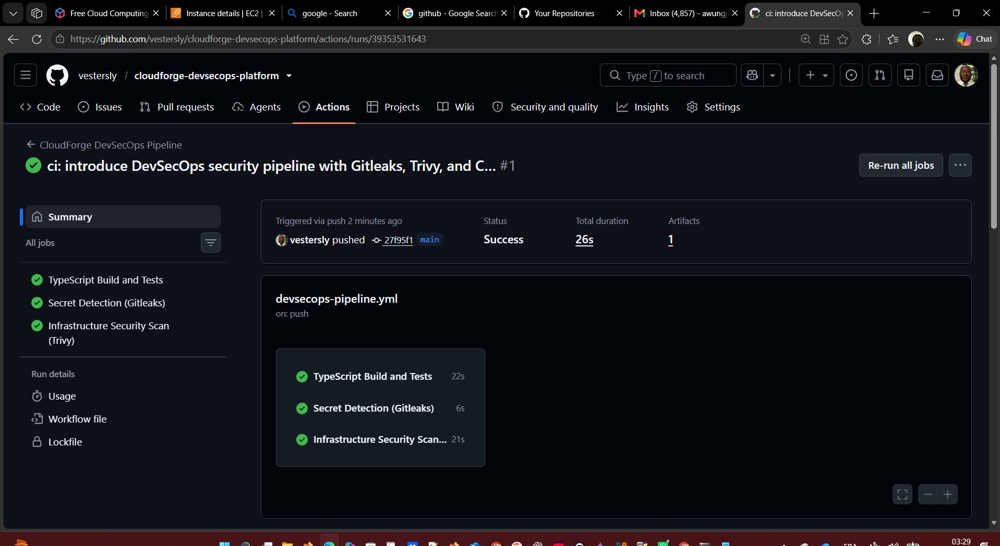
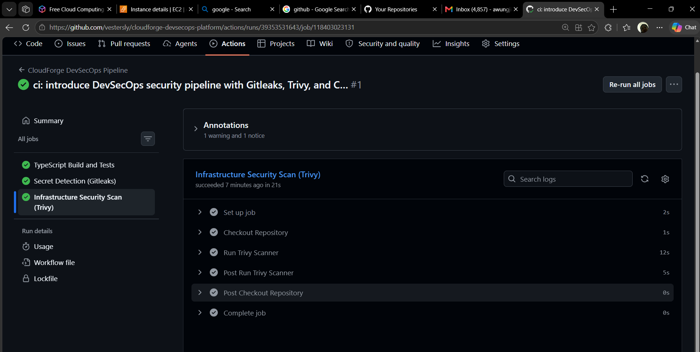
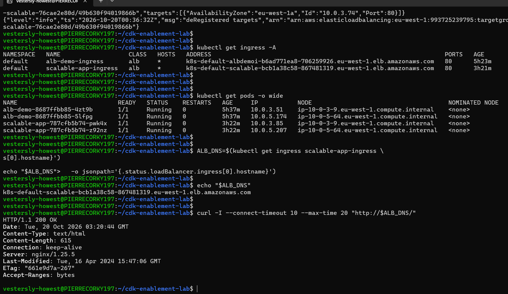
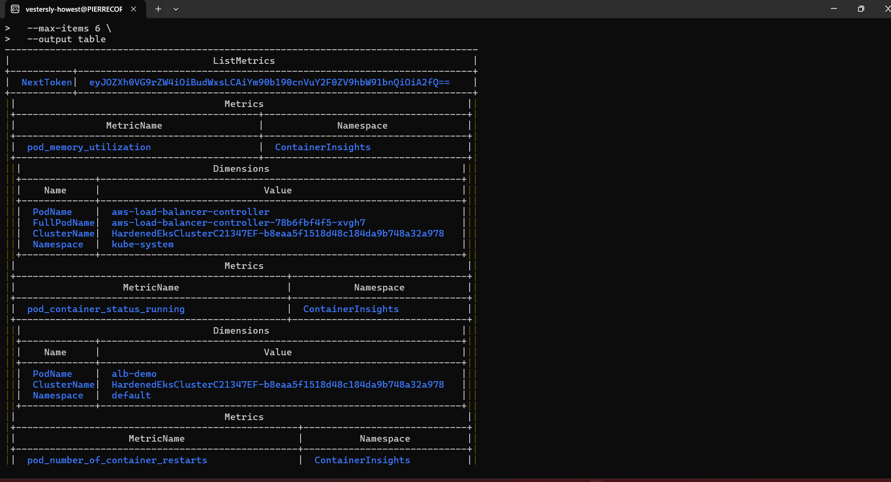

# Project Summary: Enterprise Hardened EKS & DevSecOps Platform

## Executive Summary
This project demonstrates an enterprise-grade, secure-by-default container platform deployed on AWS using AWS Cloud Development Kit (CDK v2 in TypeScript). It enforces shift-left DevSecOps automation, Kubernetes pod security admission standards, dynamic application ingress via AWS Load Balancer Controller, and infrastructure telemetry using Amazon CloudWatch Container Insights.

All infrastructure was automated via Infrastructure-as-Code (IaC), verified against strict security benchmarks, and safely decommissioned to ensure cost governance.

---

## Architecture Highlights
- **Orchestration**: Amazon EKS v1.31 running in a private multi-AZ VPC (`eu-west-1`).
- **Infrastructure as Code**: Modular AWS CDK v2 TypeScript stacks (`HardenedVpcStack`, `HardenedEksStack`).
- **DevSecOps Gate**: Automated GitHub Actions pipeline incorporating Gitleaks secret detection and Trivy vulnerability/misconfiguration scanners.
- **Pod Hardening**: Restricted pod security profile enforcing non-root execution (`runAsUser: 101`), `readOnlyRootFilesystem: true`, and complete privilege dropping (`capabilities.drop: ["ALL"]`).
- **Traffic Ingress**: AWS Load Balancer Controller managing external Application Load Balancers with IP-target routing.
- **Cloud Observability**: Managed CloudWatch Observability EKS add-on streaming container and node metrics to CloudWatch Container Insights.

---

## Visual Verification & Technical Proof

### 1. Shift-Left DevSecOps Pipeline
GitHub Actions automatically executes TypeScript unit tests, commits secret audits with Gitleaks, and blocks builds if infrastructure misconfigurations or CVEs violate security baselines.

### 2. Trivy Kubernetes Security & Compliance Scanning
Pre-deployment scanning identifies container misconfigurations and verifies compliance against CIS benchmarks and Pod Security Standards prior to manifest deployment.

### 3. AWS Application Load Balancer Routing
Kubernetes Ingress automatically provisions target groups and AWS Application Load Balancers, routing external HTTP requests directly to hardened backend pods with zero manual networking overhead.

### 4. CloudWatch Container Insights Telemetry
Operational telemetry deployed via DaemonSets streams CPU, memory utilization, and container status directly into Amazon CloudWatch for enterprise observability.

---

## Cost Governance & Lifecycle Management
To maintain financial governance and eliminate recurring AWS cloud spend, the infrastructure was audited and completely decommissioned following successful verification:
1. Dynamic Kubernetes Ingress controllers and provisioned ALBs removed via `kubectl`.
2. EKS cluster, node groups, and IAM roles torn down via `HardenedEksStack`.
3. VPC, route tables, subnets, and NAT Gateways removed via `HardenedVpcStack`.
4. Elastic IP allocation audit conducted to ensure €0.00 idle resource billing.

---

## Project Artifacts
- **Repository**: [github.com/vestersly/cloudforge-devsecops-platform](https://github.com/vestersly/cloudforge-devsecops-platform)
- **Author**: Awungjia Sylvester Bebongchu (AWS Certified Solutions Architect – Associate)
